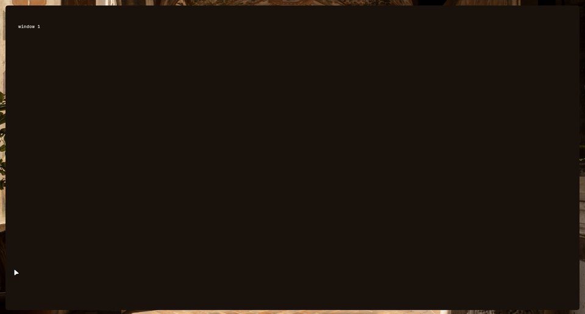
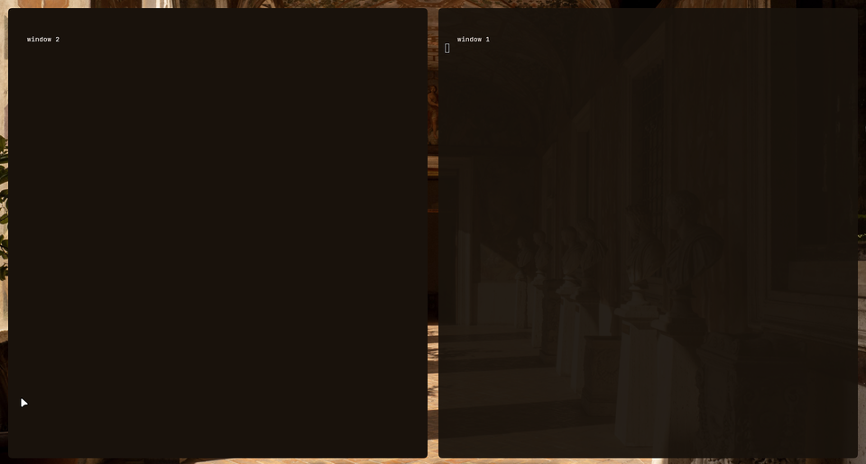
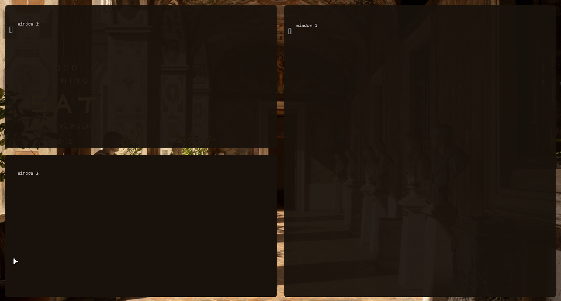
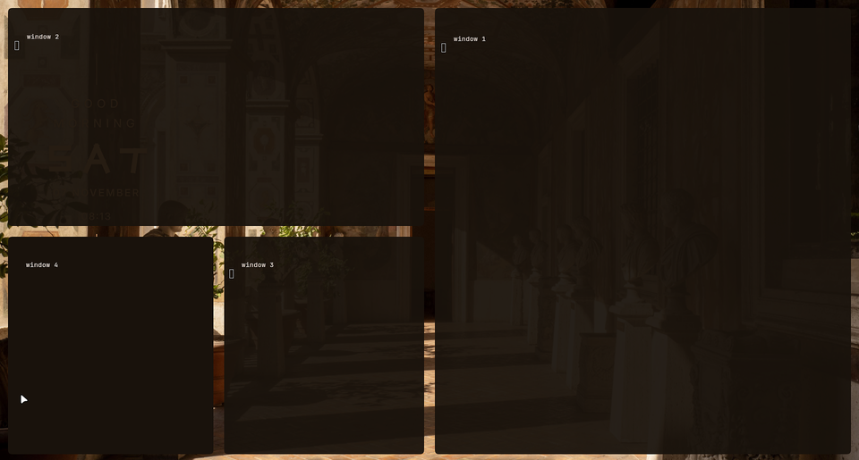
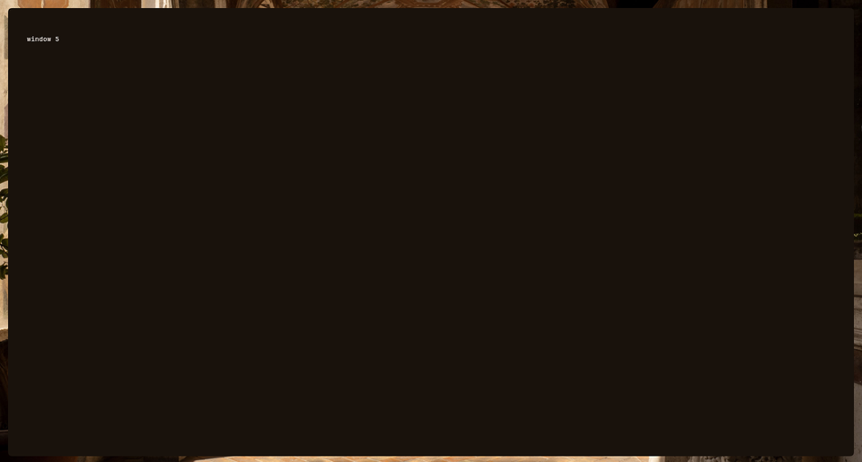

# ryoku-dwindle-tiling

A [Ryoku](https://github.com/ryoku-linux) mod that tiles windows with Hyprland's `dwindle` layout and caps each workspace at four tiled windows. The fifth window moves to the next workspace and focus follows it. Ryoku's default `scrolling` layout lets columns run off-screen, so only about two windows stay visible. This mod keeps all four on screen, the way a Caelestia install tiles.

## Result

| 1 window | 2 windows |
|---|---|
|  |  |
| **3 windows** | **4 windows** |
|  |  |

The fifth window opens on the next workspace:



Captured live on Hyprland 0.56.2 by opening kitty terminals on an empty workspace.

## Install

The mod folder is `mods/dwindle-tiling` in a Ryoku `central-home` checkout.

```sh
git clone <this repo> ~/dev/central-home/ryoku/mods/dwindle-tiling
ryoku-mods off scrolling-workspaces   # both mods set the same layout key
ryoku-mods on dwindle-tiling
```

`ryoku-mods off dwindle-tiling` sets the layout back to `scrolling`.

## Configure

Edit `config.lua`, then run `hyprctl reload`. `ryoku-mods reapply` alone does not reload the compositor.

| Key | Default | Meaning |
|---|---|---|
| `max_tiled` | `4` | Tiled windows per workspace before the next one moves on |
| `per_desktop` | `10` | Workspace ids per desktop (matches `scripts/ryoku-workspace`) |
| `follow` | `true` | Focus the workspace the window moved to |

Floating and pinned windows do not count. When every workspace in the desktop is full, the window stays where it opened.

## Tested

- Caps of 4 and 2 on live kitty windows: 4+1 and 2+1 across workspaces 5 and 6.
- `ryoku-mods off` and `on` flip the layout between `scrolling` and `dwindle`.
- Not tested: a completely full desktop, and the `ryoku update` path.

## Files

`mod.json` (mod manifest), `tile.lua` (window handler), `config.lua` (settings).
