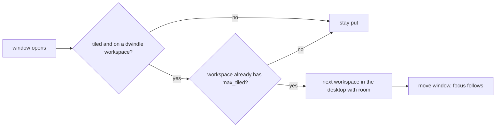

# ryoku-dwindle-tiling

A [Ryoku](https://github.com/ryoku-linux) mod that tiles windows with Hyprland's `dwindle` layout and caps each workspace at four tiled windows. The fifth window moves to the next workspace and focus follows it. Ryoku's default `scrolling` layout lets columns run off-screen, so only about two windows stay visible. This mod keeps all four on screen, the way a Caelestia install tiles.

## Result

| 1 window | 2 windows |
|---|---|
|  |  |
| **3 windows** | **4 windows** |
|  |  |

The fifth window opens on the next workspace:


## Install

The mod folder is `mods/dwindle-tiling` in a Ryoku `central-home` checkout.

```sh
git clone <this repo> ~/dev/central-home/ryoku/mods/dwindle-tiling
ryoku-mods off scrolling-workspaces   # both mods set the same layout key
ryoku-mods on dwindle-tiling
```

`ryoku-mods off dwindle-tiling` sets the layout back to `scrolling`.

## Configure

Edit `config.lua`, then run `hyprctl reload`. `ryoku-mods reapply` alone does not reload the compositor.

| Key | Default | Meaning |
|---|---|---|
| `max_tiled` | `4` | Tiled windows per workspace before the next one moves on |
| `per_desktop` | `10` | Workspace ids per desktop (matches `scripts/ryoku-workspace`) |
| `follow` | `true` | Focus the workspace the window moved to |

Floating and pinned windows do not count. When every workspace in the desktop is full, the window stays where it opened.

## How it works



`mod.json` makes `ryoku-mods` set the Hub's `desktop.appearance.layout` to `dwindle` (and back to `scrolling` on `off`) and load `tile.lua` from the `user.lua` mods block.

## Limitations

- Requires Ryoku with `ryoku-mods` and Hyprland's Lua config API.
- Only the active layout `dwindle` is capped. Floating and pinned windows are never moved.
- When every workspace in the desktop is full, the new window stays on its own workspace.
- The mod conflicts with `scrolling-workspaces`, which sets the same layout key. Turn that one off first.
- Changes to `config.lua` need `hyprctl reload`.

## Files

```
ryoku-dwindle-tiling/
├── mod.json      mod manifest: layout key and Lua entry
├── tile.lua      window.open handler with the cap
├── config.lua    max_tiled, per_desktop, follow
├── docs/         README screenshots
├── LICENSE
└── README.md
```
